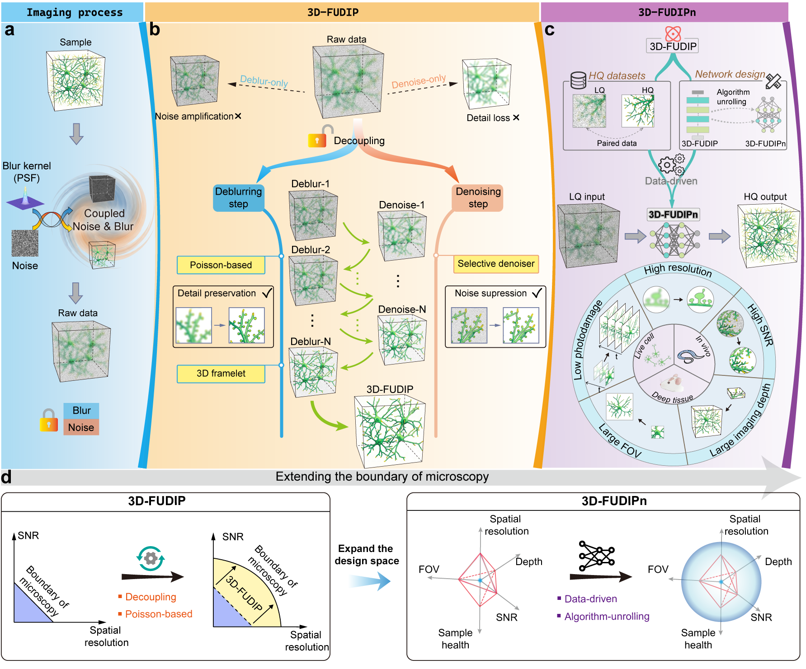
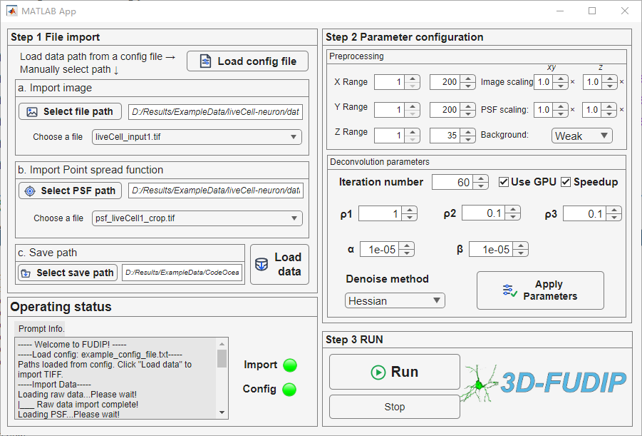

## Introduction

This capsule provides the implementation of **3D-FUDIP** and **3D-FUDIPn**, the methods presented in the following paper:

> **"A physics-consistent framework for stable live 3D fluorescence microscopy under photon-limited conditions"**

> Representative datasets associated with this work are publicly available on Zenodo at https://zenodo.org/records/21522444. The source code will be released and continuously maintained at https://github.com/WeLab-ZJU/3D-FUDIP.


## Overview

**3D-FUDIP** is a physics-consistent framework designed for stable 3D fluorescence microscopy reconstruction under photon-limited conditions. By formulating the reconstruction as a unified inverse problem governed by Poisson photon statistics, it enables high-quality imaging even at low photon counts.

The framework provides two complementary approaches:

- **3D-FUDIP**: A robust iterative deconvolution method. It explicitly enforces Poisson-based data fidelity and decouples noise suppression from blur inversion, ensuring stable reconstruction and maximized image quality within a limited photon budget.
- **3D-FUDIPn**: A deep-learning-enhanced implementation using algorithm unrolling. It offers an efficient, scalable, and high-speed solution suitable for routine experimental deployment and large-scale data processing.




We provide three distinct implementations to accommodate different workflows and research requirements:

| Implementation   | Language            | Description                                                                                               |
| ---------------- | ------------------- | --------------------------------------------------------------------------------------------------------- |
| **3D-FUDIP**     | MATLAB              | MATLAB scripts for 3D-FUDIP                                                                               |
| **3D-FUDIP App** | MATLAB | GUI-based MATLAB App, provided as a standalone installer for researchers who prefer a graphical workflow |
| **3D-FUDIPn**    | Python              | Python implementation for network training and inference of 3D-FUDIPn                                     |

## Data Requirements

### 3D-FUDIP

The maximum processable volume size is primarily constrained by the available GPU memory. Typically, a standard 24 GB GPU can process volumes up to $512 \times 512 \times 64$ voxels. The peak GPU memory consumption of 3D-FUDIP is inherently higher than conventional deconvolution methods (e.g., DeconvolutionLab2 and Sparse deconvolution) due to the intermediate tensor allocation required for the 3D framelet transform. 

To accommodate hardware with limited GPU memory, CPU-based inference is supported as a fallback. This alternative significantly reduces the GPU memory usage, albeit with an increase in computational time. Furthermore, memory-efficient implementations of the framelet transform are currently under development to reduce the overall memory overhead in future releases.

After obtaining several paired data using 3D-FUDIP, you can train a 3D-FUDIPn model to reduce the memory and time consumption of deconvolution.

### 3D-FUDIPn

For optimal training performance, the axial dimension ($z$-size) of the training patches should be at least 16 voxels. Setting the $z$-size to 8 restricts the number of downsampling layers in the U-Net architecture, which limits the network's receptive field and overall representational capacity.

 The recommended training patch dimensions ( $x \times y \times z$ ) are: $128 \times 128 \times 64$,  $192 \times 192 \times 32$, $256 \times 256 \times 16$.


## System Requirements

### Software
- **3D-FUDIP**: MATLAB R2021a or later; requires Parallel Computing Toolbox for [GPU acceleration](https://www.mathworks.com/help/parallel-computing/gpu-computing.html).
- **3D-FUDIP App**: MATLAB R2024a or later.
- **3D-FUDIPn**: Python 3.12 or later with [PyTorch](https://pytorch.org/) (GPU acceleration required).

### Hardware
- **GPU**: Minimum 12 GB VRAM (>24 GB VRAM recommended).
- **RAM**: Minimum 16 GB (>32 GB recommended).

> For substantial speedup and reduced memory usage, mixed-precision training is recommended on GPUs based on the NVIDIA Ampere architecture or newer (e.g., RTX 3090 and above).

### Operating Systems
- **Linux**: Tested on Ubuntu 20.04.1 LTS.
- **Windows**: Tested on Windows 10.

### Test Environment
- **CPU**: Intel® Xeon® Gold 5218 @ 2.30GHz.
- **GPU**: NVIDIA GeForce RTX Titan (24 GB VRAM), NVIDIA GeForce RTX 3090 (24 GB VRAM), NVIDIA RTX 5000 Ada Generation (32 GB VRAM), and NVIDIA GeForce RTX 4090 (24 GB VRAM).
- **MATLAB**: R2021a and R2025a.

## Installation
### 3D-FUDIP-MATLAB & 3D-FUDIP-App

To use 3D-FUDIP-App, please clone/download this repository, and run the `FUDIP_APP.mlapp` with MATLAB.


### 3D-FUDIPn

To use 3D-FUDIPn, please create a virtual environment using conda/mamba and install PyTorch. 

```
mamba create -n fudipn python=3.12 -y
mamba activate fudipn
```


Please select the correct PyTorch version that matches your CUDA version from https://pytorch.org/get-started/previous-versions/.

Install PyTorch using Mamba or Conda:

```
mamba install pytorch torchvision cudatoolkit -c pytorch 
```

Alternatively, install PyTorch using pip:

```
pip install torch==2.10.0 torchvision==0.25.0 --index-url https://download.pytorch.org/whl/cu128
```

Install other dependencies using the provided `requirements.txt`:

```
pip install -r requirements.txt
```

Navigate to /code/3D-FUDIPn and install `basicsr`

```
cd /code/3D-FUDIPn
python setup.py develop --no-build-isolation
```

## Usage
### 3D-FUDIP
- Run the `FUDIP_MATLAB_APP.mlapp` with MATLAB. 
- Prepare your microscopy data (e.g., .tif files) and matched PSF file and put them into an appropriate directory (e.g., ./data/).
- Setup output directory for the output.
- Click the "Load the image and PDF" button to load your microscopy data and PSF file. (Setting a data path config file as an alternative option.)
- Configure the parameters in the right panel as required.
- Click the "Aplly parameters" button to apply the parameters.
- Click the "Run" button to start the deconvolution process.



Detailed instructions about how to get appropriate PSF file and setup 3D-FUDIP-App will be provided and updated in the `wiki` folder.


### 3D-FUDIPn

- Prepare the training and validation datasets, each containing paired high- and low-quality .tif images. 

#### Training 

- Configure training by editing the appropriate `.yml` file in `FUDIPn/options/train/`. Specify the dataset paths, checkpoint settings, logging options, and other hyperparameters as needed.

- Run the `train.py` script with configuration file path to start training:

e.g. 

```
python basicsr/train.py -opt options/train/FUDIPn/train_FUDIPn_neuron_dataset.yml
```

#### Inference

- Place the pretrained model (`.pth` file) in an appropriate directory, such as `./ckpt/model_best.pth`.

- Specify the model path in the inference configuration file or set `DEFAULT_CHECKPOINT` in the inference script.

- Run `inference_fudipn.py` to perform inference on the paired datasets:

```
python scripts/network_inference/inference_fudipn.py
```

- Alternatively, after completing the required configuration, run the script directly in an IDE such as PyCharm.

- Run the `apply_big_data_40xSR.py` to perform inference on the large size data. This script is used to process large size data in a batch manner.

## Acknowledge

We acknowledge the following projects and papers for providing code that significantly contributed to this work:

- [regDeconProject](https://github.com/eguomin/regDeconProject)
- [Sparse-SIM](https://github.com/WeisongZhao/Sparse-SIM)
- [3D-RCAN](https://github.com/AiviaCommunity/3D-RCAN)
- [DGUNet](https://github.com/MC-E/Deep-Generalized-Unfolding-Networks-for-Image-Restoration)
- [DeepCAD](https://github.com/cabooster/DeepCAD)
- Gao H, Li R, Lin Y, Xing L. 4D cone beam CT via spatiotemporal tensor framelet. Med Phys. 2012 Nov;39(11):6943-6. doi: 10.1118/1.4762288.


